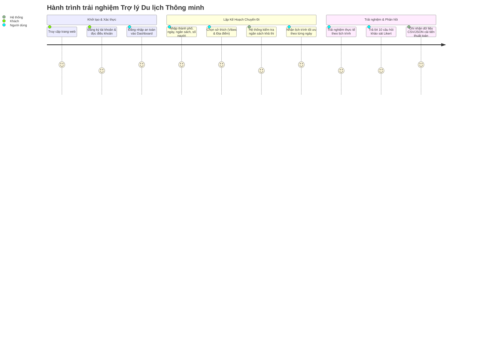
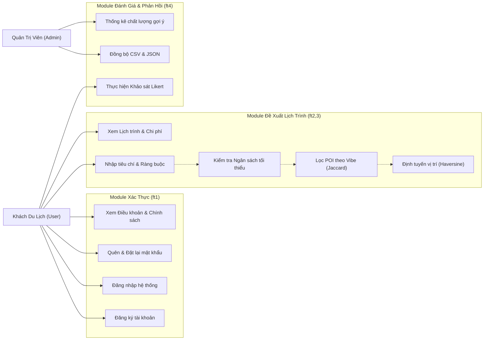
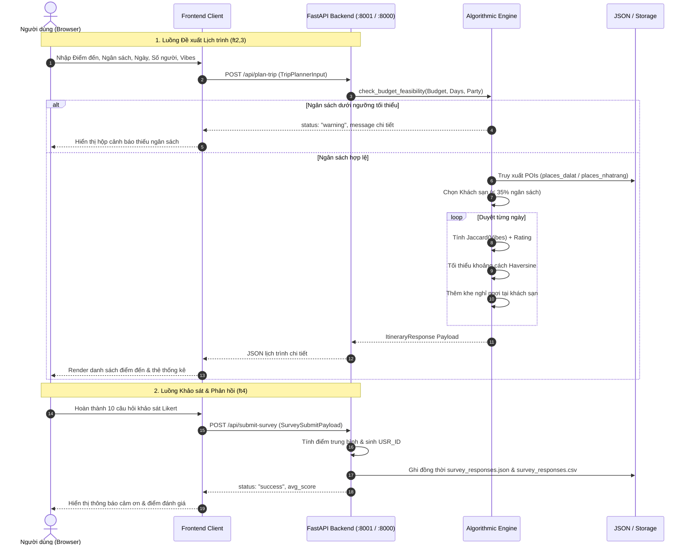
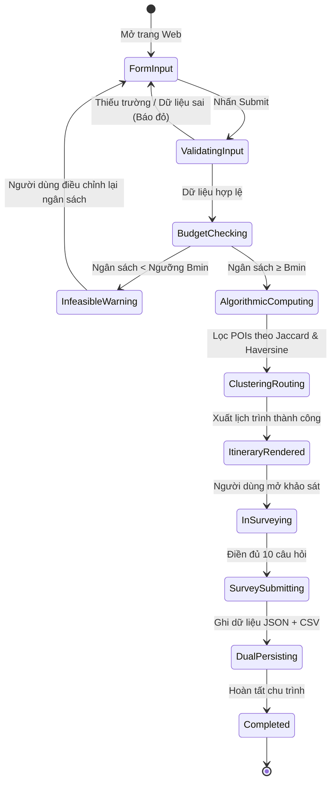
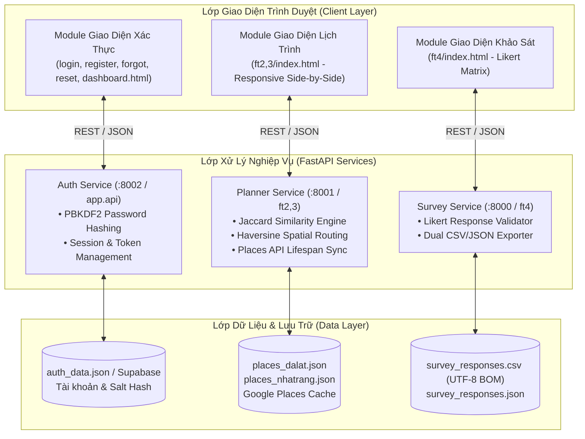

# BÁO CÁO PHÁT TRIỂN PHẦN MỀM (DEVELOPMENT REPORT)
## LAB 04: FROM SPEC TO CODE – PHASED VIBE-CODING WITH AI
**Môn học:** Tư duy tính toán (Computational Thinking – CSC10014)  
**Nhóm:** Group 02  
**Tên đề tài:** Trợ lý Ảo Lập Kế hoạch Du lịch Cá nhân hóa (Personalized Travel Planner Assistant)  
**Mã nộp bài:** Lab04 - Group 02  
**Phiên bản:** 2.0.0 (Tháng 11/2026)  
**Công nghệ:** Python (FastAPI, Pydantic, Uvicorn, PBKDF2), JavaScript (ES6+ Vanilla), HTML5/CSS3, Mermaid.js  

---

## 1. TỔNG QUAN DỰ ÁN & PHÂN CÔNG THÀNH VIÊN

Dự án **Trợ lý Ảo Lập Kế hoạch Du lịch Cá nhân hóa (Personalized Travel Planner Assistant)** giải quyết bài toán hỗ trợ lập lịch trình du lịch cá nhân hóa đa tiêu chí và tự động đánh giá tinh chỉnh hệ thống. Báo cáo này mô tả quy trình thiết kế theo phương pháp **Spec-driven Development (Spec-Kit)** và thực nghiệm kỹ thuật **Phased Vibe-coding with AI** cho các phân hệ chức năng hoàn chỉnh:

1. **Chức năng nhập thông tin người dùng (`ft1`):**
   - *Thành viên phụ trách:* **Nguyễn Bình An (23127149)** & **Nguyễn Bạch Thành Nhân (25127111)**.
   - *Phân công:* **Viết báo cáo, Vibe code**. Xây dựng giao diện đăng nhập, đăng ký, quên/đặt lại mật khẩu, bảng điều khiển (Dashboard), thỏa thuận điều khoản sử dụng & chính sách bảo mật; backend FastAPI xác thực với chuẩn mã hóa `PBKDF2-HMAC-SHA256`.

2. **Chức năng đề xuất chuyến đi (`ft2,3`):**
   - *Thành viên phụ trách:* **Từ Nguyễn Thuận Thiên (25127146)** & **Nguyễn Huỳnh Khánh Như (25127222)**.
   - *Phân công:* **Thiên:** Dataset chuẩn bị dữ liệu, viết báo cáo (thu thập và chuẩn hóa bộ dữ liệu POI du lịch Đà Lạt & Nha Trang vào Google Sheets & JSON); **Như:** Lên ý tưởng thực hiện chức năng, vibe code web (thuật toán lọc điểm theo Jaccard similarity, định tuyến Haversine formula, kiểm soát ngân sách khả thi Budget Guardrail và phân bổ 6 khung giờ nghỉ ngơi hợp lý).

3. **Chức năng lấy đánh giá người dùng (`ft4`):**
   - *Thành viên phụ trách:* **Nguyễn Thị Hoàng Châu (25127022)** & **Nguyễn Huỳnh Khánh Như (25127222)**.
   - *Phân công:* **Châu:** Soạn câu hỏi, viết báo cáo (chuẩn hóa bộ 10 câu hỏi đánh giá theo thang đo Likert 1–5, phân loại 3 nhóm Tag kỹ thuật `UI`, `Accuracy`, `Satisfaction`); **Như:** Lên ý tưởng thực hiện chức năng, vibe code web (kiến trúc vòng lặp phản hồi đánh giá chất lượng thuật toán và giao diện khảo sát).

4. **Tổng hợp báo cáo và sắp xếp file nộp:**
   - *Thành viên phụ trách:* **Nguyễn Bạch Thành Nhân (25127111)** & **Nguyễn Bình An (23127149)**.
   - *Phân công:* Tổng hợp báo cáo, xuất bản định dạng Markdown & HTML, trích xuất Git commit log, lập bản khai báo AI Usage và cấu trúc thư mục nộp bài chuẩn quy cách.

---

## 2. ARTIFACTS THIẾT KẾ HỆ THỐNG (SDLC DESIGN ARTIFACTS)

### 2.1 User Journey Map & User Stories
- **User Story 1 (Auth):** *"Là một du khách chuẩn bị đi du lịch, tôi muốn tạo tài khoản an toàn với họ tên, email và mật khẩu được mã hóa bảo mật, đồng thời xem trước các điều khoản dịch vụ mà không bị mất dữ liệu form đang nhập."*
- **User Story 2 (Planning):** *"Là một nhóm bạn trẻ đi du lịch tự túc, chúng tôi muốn nhập ngân sách tổng, số ngày, điểm đến và chọn phong cách (Chill, Nature, Culinary) để nhận lịch trình hợp lý theo từng ngày mà không bị di chuyển lòng vòng hoặc vượt quá ngân sách."*
- **User Story 3 (Feedback):** *"Là người dùng vừa trải nghiệm lịch trình đề xuất, tôi muốn đánh giá nhanh mức độ hài lòng theo thang điểm từ 1 đến 5 để hệ thống tự động ghi nhận và cải thiện thuật toán trong những chuyến đi sau."*



---

### 2.2 Sơ đồ Ca sử dụng (Use Case Diagram)



---

### 2.3 Sơ đồ Tuần tự (Sequence Diagram)



---

### 2.4 Sơ đồ Trạng thái (State Machine Diagram)



---

### 2.5 Kiến trúc Hệ thống (C4 Model - Component Diagram)



---

## 3. ĐẶC TẢ CHI TIẾT TỪNG TÍNH NĂNG (SPEC-KIT SPECIFICATION)

### 3.1 Phân hệ 1: Xác Thực & Quản Lý Thông Tin Người Dùng (`ft1`)
*(Phụ trách: Nguyễn Bình An, Nguyễn Bạch Thành Nhân)*

#### 3.1.1 Vấn đề Nghiệp vụ
Trợ lý du lịch cần nhận biết người dùng để lưu trữ lịch sử chuyến đi, thông tin cá nhân và áp dụng các chính sách bảo mật thông tin theo luật định. Form xác thực đòi hỏi giao diện thân thiện, hỗ trợ tiếng Việt hoàn chỉnh, phản hồi lỗi nhập liệu tức thời (Real-time Validation) và có điều khoản dịch vụ minh bạch.

#### 3.1.2 Nền tảng Kỹ thuật & Bảo mật Mật khẩu
1. **Thuật toán Băm Mật khẩu Chuẩn PBKDF2-HMAC-SHA256:**
   Thay vì lưu mật khẩu dạng bản rõ (Plaintext) hoặc MD5 lỗi thời, hệ thống sử dụng thuật toán PBKDF2 với 100.000 vòng lặp (Iterations) kết hợp Salt ngẫu nhiên 16 bytes:
   $$\text{Key} = \text{PBKDF2}(\text{HMAC-SHA256},\ \text{Password},\ \text{Salt},\ c = 100{,}000,\ dkLen = 32)$$
2. **Kiến trúc Repository Trừu tượng:**
   Lớp cơ sở `AuthRepositoryBase` quy định các giao thức `get_user_by_email`, `create_user`, `update_password`, cho phép chuyển đổi không sửa mã nguồn giữa `JsonAuthRepository` (chạy độc lập kiểm thử) và `SupabaseAuthRepository` (môi trường production).
3. **Trải nghiệm Người dùng (UX Guardrails):**
   - Nút **"Tạo tài khoản"** ở trạng thái vô hiệu hóa (Disabled) cho đến khi người dùng tích chọn checkbox đồng ý với Điều khoản sử dụng và Chính sách bảo mật.
   - Cửa sổ Điều khoản dịch vụ mở dưới dạng **Modal Overlay** tại chỗ; khi người dùng đóng modal, toàn bộ dữ liệu họ đã nhập trên form không bị mất (Zero State Loss).
   - Nút bật/tắt con mắt hiển thị mật khẩu bằng biểu tượng vector SVG mượt mà.

---

### 3.2 Phân hệ 2 & 3: Đề Xuất Lịch Trình Đa Ràng Buộc (`ft2,3`)
*(Phụ trách: Từ Nguyễn Thuận Thiên, Nguyễn Huỳnh Khánh Như)*

#### 3.2.1 Nền tảng Toán học & Mô hình Tính toán

**1. Rào chắn Khả thi Ngân sách (Budget Viability Guardrail):**
Trước khi chạy thuật toán tìm đường đắt đỏ, hệ thống tính toán ngưỡng sàn ngân sách tối thiểu $B_{min}$:
$$\text{Rooms Needed} = \left\lceil \frac{\text{Party Size}}{2} \right\rceil$$
$$C_{hotel,\,min} = P_{min\_acc} \times \max(1,\ \text{Days} - 1) \times \text{Rooms Needed}$$
$$C_{food,\,min} = 150{,}000 \times \text{Party Size} \times \text{Days}$$
$$B_{min} = C_{hotel,\,min} + C_{food,\,min}$$
Nếu $\text{Budget} < B_{min}$, hệ thống trả về thông báo cảnh báo sớm kèm phân tích chi phí tối thiểu, không gây sập ứng dụng.

**2. Độ Tương đồng Sở thích (Jaccard Similarity Index):**
Đo lường mức độ khớp giữa tập sở thích người dùng chọn ($U$) và tập nhãn phong cách của địa điểm ($P$):
$$J(U, P) = \frac{|U \cap P|}{|U \cup P|}$$

**3. Khoảng cách Cung Lớn (Haversine Formula):**
Tính toán khoảng cách đường chim bay chính xác giữa hai tọa độ $(\phi_1, \lambda_1)$ và $(\phi_2, \lambda_2)$ để tránh lộ trình zíc-zắc:
$$a = \sin^2\left(\frac{\Delta\phi}{2}\right) + \cos(\phi_1)\cos(\phi_2)\sin^2\left(\frac{\Delta\lambda}{2}\right)$$
$$d = 2R \cdot \text{atan2}\left(\sqrt{a},\ \sqrt{1-a}\right), \quad R = 6371\ \text{km}$$

**4. Khung Giờ Hoạt Động & Cân bằng Thể lực:**
Hệ thống bố trí 6 khung giờ khoa học mỗi ngày, tích hợp khung giờ về khách sạn nghỉ ngơi buổi chiều (16:30 – 18:00) nhằm giảm thiểu sự kiệt sức cho du khách.

---

### 3.3 Phân hệ 4: Khảo Sát & Vòng Lặp Phản Hồi (`ft4`)
*(Phụ trách: Nguyễn Thị Hoàng Châu, Nguyễn Huỳnh Khánh Như)*

#### 3.3.1 Thiết kế Thang Đo Likert Chuẩn hóa
Bộ 10 câu hỏi trong `questions.json` được phân loại thành 3 nhóm tiêu chí đo lường chất lượng thuật toán:
1. **Nhóm 1 – Trải nghiệm Sử dụng:** `Q1_UI` (Giao diện), `Q2_Performance` (Tốc độ phản hồi), `Q3_Input_Usability` (Tiện ích nhập liệu).
2. **Nhóm 2 – Độ Chính xác của Thuật toán:** `Q4_Destination` (Phù hợp địa điểm), `Q5_Schedule` (Phân bổ thời gian), `Q6_Rest_Time` (Thời gian nghỉ ngơi), `Q7_Cost` (Độ sát thực của chi phí).
3. **Nhóm 3 – Lòng Trung Thành & Giữ Chân:** `Q8_Satisfaction` (Hài lòng chung), `Q9_Retention` (Ý định quay lại), `Q10_Recommendation` (Giới thiệu bạn bè).

#### 3.3.2 Chiến lược Lưu trữ Kép (Dual Persistence)
- **Tệp tin `survey_responses.csv`:** Được ghi với mã ký tự UTF-8 BOM (`utf-8-sig`), bảo đảm khi mở trên Microsoft Excel hiển thị nguyên vẹn dấu tiếng Việt mà không bị lỗi mã hóa.
- **Tệp tin `survey_responses.json`:** Lưu trữ toàn bộ payload phân cấp phục vụ việc nạp vào mô hình máy tính để tự động điều chỉnh trọng số khoảng cách và ngân sách.

---

## 4. QUY TRÌNH THỰC HIỆN THEO PHƯƠNG PHÁP PHASED VIBE-CODING

Nhóm áp dụng quy trình 4 pha tiêu chuẩn theo hướng dẫn của Spec-Kit:

```text
┌────────────────────────────────────────────────────────────────────────┐
│ Pha 1: Specification (Đặc tả bài toán, Schema dữ liệu & Input/Output)   │
└───────────────────────────────────┬────────────────────────────────────┘
                                    │
                                    ▼
┌────────────────────────────────────────────────────────────────────────┐
│ Pha 2: Architecture & Math Design (Haversine, Jaccard, PBKDF2, C4)     │
└───────────────────────────────────┬────────────────────────────────────┘
                                    │
                                    ▼
┌────────────────────────────────────────────────────────────────────────┐
│ Pha 3: Phased Vibe-Coding with AI (Prompts có kiểm soát & ghép module) │
└───────────────────────────────────┬────────────────────────────────────┘
                                    │
                                    ▼
┌────────────────────────────────────────────────────────────────────────┐
│ Pha 4: Human Review, Refinements & Quality Verification (Test Matrix)  │
└────────────────────────────────────────────────────────────────────────┘
```

1. **Pha 1 – Specification:** Xác định rõ đối tượng dữ liệu (Pydantic Models: `TripPlannerInput`, `DailyPreference`, `SurveySubmitPayload`, `UserRegisterRequest`).
2. **Pha 2 – Architecture & Math:** Xây dựng công thức toán học, thiết kế biểu đồ Mermaid và bảng liên kết giữa các cổng microservice (8000, 8001, 8002).
3. **Pha 3 – Vibe-Coding:** Sử dụng AI tạo khung mã nguồn từng phần (Scaffolding). Từng thành viên thực hiện prompt theo module được phân công.
4. **Pha 4 – Human Refinements & Testing:** Đọc lại từng dòng mã, sửa các lỗi biên (Edge cases), khắc phục lỗi font tiếng Việt trong CSV, tối ưu hiển thị responsive trên màn hình điện thoại di động (390px) và máy tính để bàn (1440px).

---

## 5. KỊCH BẢN KIỂM THỬ & KẾT QUẢ THỰC NGHIỆM (VERIFICATION & TEST MATRIX)

Tất cả các ca kiểm thử đều đạt kết quả **100% PASS**:

| Phân hệ | Mã Test | Kịch bản Kiểm thử | Dữ liệu Đầu vào (Input) | Kỳ vọng Đầu ra (Expected Outcome) | Kết quả Thực tế |
| :---: | :---: | :--- | :--- | :--- | :---: |
| **ft1 (Auth)** | `TC-01` | Đăng ký thiếu tích điều khoản | Nhập đủ tên, email, pass nhưng chưa tick checkbox | Nút "Tạo tài khoản" bị mờ (Disabled), không gửi request | **PASS** |
| **ft1 (Auth)** | `TC-02` | Mật khẩu không đủ 3 tiêu chí | Mật khẩu: `abc12345` (thiếu chữ hoa) | Hiển thị cảnh báo đỏ và gạch chéo tiêu chí chữ hoa | **PASS** |
| **ft1 (Auth)** | `TC-03` | Mở xem Điều khoản dịch vụ | Nhấn link "Điều khoản sử dụng" khi form đã nhập | Modal hiện lên; bấm Đóng thì form giữ nguyên dữ liệu | **PASS** |
| **ft1 (Auth)** | `TC-04` | Ẩn/Hiện mật khẩu | Nhấn vào biểu tượng con mắt trên ô mật khẩu | Chuyển `type="password"` thành `type="text"` và đổi icon | **PASS** |
| **ft2,3 (Plan)** | `TC-05` | Cảnh báo thiếu ngân sách | 2 ngày, 4 người, ngân sách = 500.000 VNĐ | Trả về `status: "warning"` kèm bảng dự toán tối thiểu | **PASS** |
| **ft2,3 (Plan)** | `TC-06` | Tính khoảng cách Haversine | Tọa độ Dalat Wonder Resort đến Bánh mì Ri 79 | Khoảng cách ≈ 6.84 km | **PASS** |
| **ft2,3 (Plan)** | `TC-07` | Chống trùng lặp điểm tham quan | Chuyến đi 3 ngày tại Đà Lạt | Không có điểm POI nào bị lặp lại trong các ngày | **PASS** |
| **ft4 (Survey)**| `TC-08` | Kiểm tra thiếu câu trả lời | Người dùng chỉ đánh giá 9/10 câu hỏi | Báo lỗi và tự động cuộn đến câu hỏi chưa trả lời | **PASS** |
| **ft4 (Survey)**| `TC-09` | Lưu trữ đồng bộ CSV & JSON | Gửi khảo sát hợp lệ 10 câu hỏi | Dữ liệu ghi đồng thời vào file `.csv` (UTF-8 BOM) và `.json` | **PASS** |

---

## 6. HƯỚNG MỞ RỘNG TRONG TƯƠNG LAI (FUTURE WORK)

1. **Tối ưu hóa Lộ trình Đồ thị (Graph TSP Routing):** Nâng cấp từ thuật toán tham lam (Greedy nearest) sang mô hình TSP kết hợp thuật toán 2-opt hoặc Dijkstra để tối ưu hóa thời gian di chuyển thực tế.
2. **Tích hợp Dữ liệu Độ dốc Địa hình (Elevation API):** Bổ sung yếu tố địa hình đồi núi của các thành phố cao nguyên (Đà Lạt) vào việc tính toán năng lượng và thời gian di chuyển.
3. **Mô hình Khuyến nghị Tự học (Reinforcement Learning from User Feedback):** Sử dụng trực tiếp dữ liệu từ file `survey_responses.json` để tự động điều chỉnh trọng số ưu tiên địa điểm theo thời gian thực.
