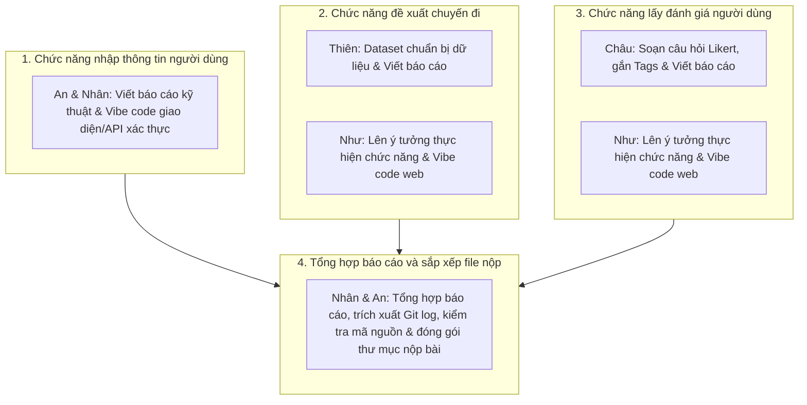

# BẢNG PHÂN CÔNG NHIỆM VỤ & ĐÓNG GÓP THÀNH VIÊN
## LAB 04: FROM SPEC TO CODE – PHASED VIBE-CODING WITH AI
**Môn học:** Tư duy tính toán (Computational Thinking – CSC10014)  
**Nhóm:** Group 02  
**Tên đề tài:** Trợ lý Ảo Lập Kế hoạch Du lịch Cá nhân hóa (Personalized Travel Planner Assistant)  
**Mã gói nộp bài:** Lab04 - Group 02  

---

## 1. BẢNG PHÂN CÔNG NHIỆM VỤ THEO CHỨC NĂNG (TASK DISTRIBUTION)

| STT | Chức năng / Hạng mục công việc | Thành viên phụ trách | MSSV | Công việc cụ thể | Mức độ đóng góp |
| :---: | :--- | :--- | :---: | :--- | :---: |
| **1** | **Chức năng nhập thông tin người dùng** | **Nguyễn Bình An** **Nguyễn Bạch Thành Nhân** | 23127149 25127111 | • **Viết báo cáo:** Đặc tả yêu cầu người dùng, sơ đồ ca sử dụng (Use Case), sơ đồ tuần tự (Sequence Diagram), thiết kế bảo mật mật khẩu PBKDF2-SHA256 và lập kịch bản kiểm thử. • **Vibe code:** Vibe-code giao diện web Responsive (Login, Register, Forgot Password, Reset Password, Dashboard, Terms, Privacy) và backend API FastAPI xác thực. | **100%** **100%** |
| **2** | **Chức năng đề xuất chuyến đi** | **Từ Nguyễn Thuận Thiên**  **Nguyễn Huỳnh Khánh Như** | 25127146  25127222 | • **Thuận Thiên:** Dataset chuẩn bị dữ liệu (làm sạch, chuẩn hóa POI Đà Lạt & Nha Trang, tọa độ GPS, giá vé, giờ mở cửa vào Google Sheets & JSON), viết phần báo cáo dữ liệu và thuật toán. • **Khánh Như:** Lên ý tưởng thực hiện chức năng (luồng đề xuất theo Vibes, ràng buộc ngân sách và khung giờ nghỉ ngơi), vibe code web (`ft2,3/index.html`, `ft2,3/main.py`). | **100%**  **100%** |
| **3** | **Chức năng lấy đánh giá người dùng** | **Nguyễn Thị Hoàng Châu**  **Nguyễn Huỳnh Khánh Như** | 25127022  25127222 | • **Hoàng Châu:** Soạn bộ 10 câu hỏi khảo sát chuẩn hóa thang đo Likert 1–5 (`questions.json`, `câu hỏi khảo sát.md`), phân loại 3 nhóm Tag (`UI`, `Accuracy`, `Satisfaction`), viết báo cáo chi tiết chức năng khảo sát. • **Khánh Như:** Lên ý tưởng thực hiện chức năng (kiến trúc vòng lặp phản hồi đánh giá thuật toán), vibe code web (`ft4/index.html`, `ft4/main.py`). | **100%**  **100%** |
| **4** | **Tổng hợp báo cáo và sắp xếp file nộp** | **Nguyễn Bạch Thành Nhân** **Nguyễn Bình An** | 25127111 23127149 | • **Thành Nhân & Bình An:** Tổng hợp toàn bộ báo cáo của các thành viên, hoàn thiện tài liệu kỹ thuật Spec-Kit, trích xuất Git commit log, lập bản khai báo AI Usage Declaration, sắp xếp và kiểm tra tính toàn vẹn của mã nguồn cùng ảnh chụp minh họa trong thư mục nộp bài `submissions/Lab04/`. | **100%** **100%** |

---

## 2. BẢNG TỔNG HỢP THEO THÀNH VIÊN (MEMBER CONTRIBUTION SUMMARY)

| STT | Họ và Tên | MSSV | Vai trò | Nhiệm vụ chính trong Lab 04 | Mức độ hoàn thành |
| :---: | :--- | :---: | :--- | :--- | :---: |
| 1 | **Từ Nguyễn Thuận Thiên** | 25127146 | Developer & Data | Chức năng đề xuất chuyến đi (dataset chuẩn bị dữ liệu, viết báo cáo) | **100%** |
| 2 | **Nguyễn Huỳnh Khánh Như** | 25127222 | Team Leader & Logic | Chức năng đề xuất chuyến đi (lên ý tưởng, vibe code web); Chức năng lấy đánh giá người dùng (lên ý tưởng, vibe code web) | **100%** |
| 3 | **Nguyễn Thị Hoàng Châu** | 25127022 | Product Analyst | Chức năng lấy đánh giá người dùng (soạn câu hỏi, viết báo cáo) | **100%** |
| 4 | **Nguyễn Bạch Thành Nhân** | 25127111 | QA & Documentation | Chức năng nhập thông tin người dùng (viết báo cáo, vibe code); Tổng hợp báo cáo và sắp xếp file nộp | **100%** |
| 5 | **Nguyễn Bình An** | 23127149 | Lead Dev & Integrator | Chức năng nhập thông tin người dùng (viết báo cáo, vibe code); Tổng hợp báo cáo và sắp xếp file nộp | **100%** |

---

## 3. SƠ ĐỒ PHÂN BỔ NHIỆM VỤ THEO LUỒNG CÔNG VIỆC

---

## 4. ĐÁNH GIÁ CỦA NHÓM
- **Mức độ hoàn thành:** Tất cả 5/5 thành viên đã hoàn thành 100% các đầu việc được phân công đúng thời hạn.
- **Tính phối hợp:** Các chức năng được phân chia rõ ràng nhưng có sự liên kết chặt chẽ giữa thiết kế dữ liệu, ý tưởng nghiệp vụ và triển khai mã nguồn thực tế.
